# SƠ ĐỒ QUAN HỆ THỰC THỂ (ERD) & KIẾN TRÚC CƠ SỞ DỮ LIỆU NETWORD
**Dự án:** NETWORD – Từ điển ngôn ngữ trên không gian mạng dành cho học sinh THPT  
**Chuyên đề 2:** Tìm hiểu ngôn ngữ trong đời sống xã hội hiện đại (Ngữ văn 11)  
**Đơn vị:** Trường THCS và THPT Long Hiệp  
**Giáo viên phát triển:** Thầy Trầm Thanh Tuấn (`tramthanhtuanlh@gmail.com`)  

---

## 1. Sơ đồ thực thể quan hệ (Mermaid ERD)

```mermaid
erDiagram
    PROFILES ||--o{ TERMS : "tạo / quản lý"
    PROFILES ||--o{ SUBMISSIONS : "đề xuất từ"
    PROFILES ||--o{ REVIEWS : "thẩm định"
    PROFILES ||--o{ FAVORITES : "lưu yêu thích"
    PROFILES ||--o{ QUIZ_ATTEMPTS : "làm thử thách"
    PROFILES ||--o{ ACTIVITY_LOGS : "thực hiện hành động"
    PROFILES ||--o{ REPORTS : "phản ánh"

    TERMS ||--|{ TERM_MEANINGS : "có 1 hoặc nhiều nghĩa"
    TERMS ||--o{ TERM_EXAMPLES : "có nhiều ngữ cảnh đối thoại"
    TERMS ||--o{ TERM_SOURCES : "có nguồn khảo sát thực địa"
    TERMS ||--o{ TERM_REVISIONS : "lưu vết lịch sử biên tập"
    TERMS ||--o{ FAVORITES : "được yêu thích"
    TERMS ||--o{ REPORTS : "bị phản ánh"
    TERMS ||--o{ REVIEWS : "kết quả thẩm định"

    TERM_MEANINGS ||--o{ TERM_EXAMPLES : "áp dụng cho nghĩa"

    SUBMISSIONS ||--o{ REVIEWS : "được thẩm định bởi"

    QUIZ_QUESTIONS ||--o{ QUIZ_ATTEMPTS : "được trả lời trong"

    PROFILES {
        UUID id PK
        TEXT email
        TEXT full_name
        TEXT role "student | editor | teacher_admin"
        TEXT school
        TEXT grade
        INTEGER points
    }

    TERMS {
        UUID id PK
        TEXT term
        TEXT normalized_term "UNIQUE - chống trùng lặp"
        TEXT category "slang | teencode | meme_trend | borrowed | game_stream | school"
        TEXT status "draft | pending | needs_revision | published | rejected | archived"
        UUID author_id FK
        TEXT[] tags
        INTEGER likes_count
        INTEGER views_count
    }

    TERM_MEANINGS {
        UUID id PK
        UUID term_id FK
        INTEGER meaning_order
        TEXT meaning_type "net_meaning | literal_meaning | extended_meaning | metaphoric_meaning"
        TEXT definition
        TEXT academic_guidance "Lời dặn GV Ngữ văn 11"
        TEXT school_appropriateness "acceptable_casual | strictly_informal | caution_required | forbidden_in_formal"
        INTEGER standard_score "1..5 sao"
    }

    TERM_EXAMPLES {
        UUID id PK
        UUID term_id FK
        UUID meaning_id FK
        TEXT context_title
        JSONB dialogue "Mảng tin nhắn [{sender, isMe, text, time}]"
        TEXT notes
    }

    TERM_SOURCES {
        UUID id PK
        UUID term_id FK
        TEXT platform "tiktok | facebook | youtube | school_campus | online_game | rap_music | forum_other"
        TEXT source_url
        TEXT cultural_context
        DATE surveyed_date
    }

    TERM_REVISIONS {
        UUID id PK
        UUID term_id FK
        UUID editor_id FK
        TEXT editor_name
        TEXT revision_summary
        JSONB previous_snapshot
        JSONB updated_snapshot
    }

    SUBMISSIONS {
        UUID id PK
        UUID submitted_by FK
        TEXT submitter_name
        TEXT word
        TEXT normalized_word
        TEXT category
        TEXT proposed_meaning
        TEXT example_context
        TEXT status "pending | approved | rejected | needs_revision"
    }

    REVIEWS {
        UUID id PK
        UUID submission_id FK
        UUID term_id FK
        UUID reviewer_id FK
        TEXT reviewer_name
        TEXT decision "approved | rejected | needs_revision"
        TEXT pedagogical_feedback
        INTEGER points_awarded
    }

    FAVORITES {
        UUID id PK
        UUID user_id FK
        UUID term_id FK
    }

    QUIZ_QUESTIONS {
        UUID id PK
        TEXT title
        TEXT category "context_awareness | slang_meaning | linguistic_purity"
        TEXT question
        JSONB options
        INTEGER correct_index "0..3"
        TEXT explanation
        INTEGER points
        TEXT unit_lesson
    }

    QUIZ_ATTEMPTS {
        UUID id PK
        UUID user_id FK
        INTEGER score
        INTEGER total_questions
        JSONB details
    }

    REPORTS {
        UUID id PK
        UUID term_id FK
        UUID reported_by FK
        TEXT reason "offensive_content | inaccurate_meaning | inappropriate_for_school | duplicate_term | other"
        TEXT details
        TEXT status "open | investigating | resolved | dismissed"
    }
```

---

## 2. Bảng tổng hợp cấu trúc quan hệ (Foreign Key Matrix)

| Bảng nguồn | Khóa ngoại | Trỏ đến bảng | Ràng buộc xóa (ON DELETE) | Mục đích nghiệp vụ |
| :--- | :--- | :--- | :--- | :--- |
| `profiles` | `id` | `auth.users(id)` | `CASCADE` | Đồng bộ tài khoản Supabase Auth |
| `terms` | `author_id` | `profiles(id)` | `SET NULL` | Giữ nguyên từ điển khi xóa tác giả |
| `term_meanings`| `term_id` | `terms(id)` | `CASCADE` | Xóa nghĩa khi xóa mục từ |
| `term_examples`| `term_id` | `terms(id)` | `CASCADE` | Xóa ví dụ khi xóa mục từ |
| `term_examples`| `meaning_id` | `term_meanings(id)` | `SET NULL` | Liên kết ngữ cảnh với nghĩa cụ thể |
| `term_sources` | `term_id` | `terms(id)` | `CASCADE` | Xóa nguồn khi xóa mục từ |
| `term_revisions`| `term_id` | `terms(id)` | `CASCADE` | Lưu lịch sử chỉnh sửa sư phạm |
| `submissions` | `submitted_by` | `profiles(id)` | `SET NULL` | Giữ lại đề xuất khảo sát học đường |
| `reviews` | `submission_id` | `submissions(id)`| `CASCADE` | Liên kết biên bản thẩm định |
| `reviews` | `term_id` | `terms(id)` | `SET NULL` | Liên kết mục từ xuất bản |
| `favorites` | `user_id` | `profiles(id)` | `CASCADE` | Xóa bookmark khi xóa user |
| `favorites` | `term_id` | `terms(id)` | `CASCADE` | Xóa bookmark khi xóa mục từ |
| `quiz_attempts`| `user_id` | `profiles(id)` | `CASCADE` | Lưu điểm số học sinh |
| `reports` | `term_id` | `terms(id)` | `CASCADE` | Tiếp nhận phản ánh mục từ |

---

## 3. Các đặc tính nghiệp vụ nổi bật

1. **Cơ chế chống trùng lặp từ ngữ (`normalized_term`):**
   - Cột `normalized_term` được tính tự động từ hàm `public.normalize_term(term)`: chuyển chữ thường, bỏ dấu tiếng Việt, bỏ khoảng trắng dư thừa.
   - Ràng buộc duy nhất `uq_terms_normalized_active UNIQUE (normalized_term)` ngăn chặn hoàn toàn việc tạo trùng các từ như `"Flex"`, `"flex"`, `"FLEX "`.
   - Hàm `public.check_duplicate_term(p_term)` hỗ trợ kiểm tra từ trùng khớp chính xác hoặc trùng một phần trước khi duyệt.

2. **Một từ có nhiều nghĩa & nhiều ví dụ:**
   - Bảng `term_meanings` cho phép 1 từ chứa đồng thời: Nghĩa mạng (`net_meaning`), Nghĩa đen/nghĩa gốc (`literal_meaning`), Nghĩa mở rộng (`extended_meaning`).
   - Mỗi nghĩa có đánh giá tính chuẩn mực (`school_appropriateness`) và thang điểm từ 1 đến 5 sao theo định hướng môn Ngữ văn 11.
   - Bảng `term_examples` lưu trữ các kịch bản đối thoại tin nhắn (`JSONB dialogue`).

3. **Bảo mật Row Level Security (RLS) tối thiểu:**
   - Khách vãng lai và học sinh chỉ đọc được các mục từ có `status = 'published'`.
   - Các trạng thái `draft`, `pending`, `needs_revision`, `rejected`, `archived` chỉ người tạo hoặc Ban Biên tập / Giáo viên mới có quyền xem và chỉnh sửa.
   - Học sinh chỉ có quyền đọc và quản lý danh sách yêu thích (`favorites`) và bài làm thử thách (`quiz_attempts`) của chính mình.
